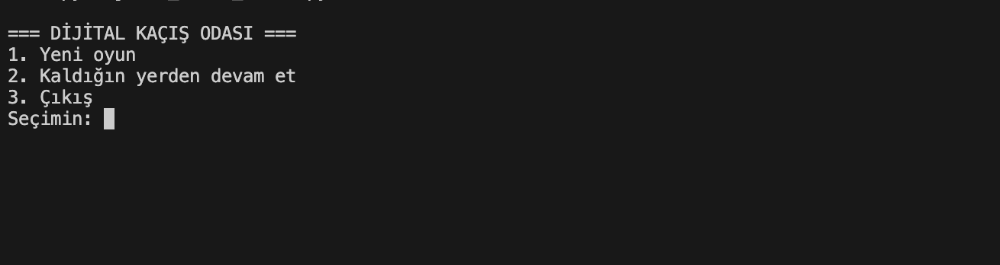
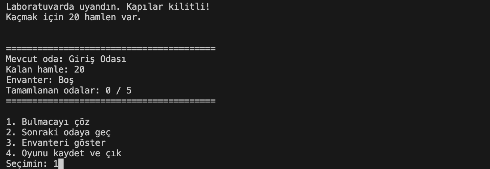
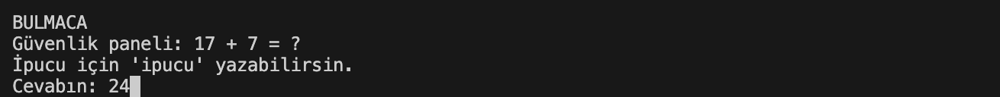
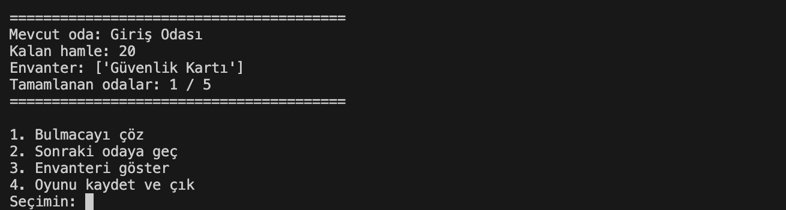

# 🔐 Digital Escape Room

A terminal-based digital escape room game developed with Python. Solve puzzles, collect items, unlock rooms, and escape from a locked research laboratory before running out of moves!

## 🎮 Features

- **Limited Moves:** Start with only 20 moves.
- **Randomized Puzzles:** Solve different puzzles generated randomly.
- **Inventory System:** Collect and manage useful items.
- **Locked Rooms:** Unlock new areas using required items.
- **Save & Load System:** Save your progress using JSON.
- **Progress Tracking:** Keep track of completed rooms and collected items.
- **Win/Lose Conditions:** Escape the laboratory or run out of moves!

## 🛠️ Technologies Used

- Python 3
- Object-Oriented Programming (OOP)
- JSON
- Random Module
- File Handling

## 🚀 Installation & Usage

1. Clone this repository:

```bash
git clone https://github.com/olcay72/digital-escape-room.git
```

2. Navigate to the project directory:

```bash
cd digital-escape-room
```

3. Run the game:

```bash
python3 dijital_kacis_odasi.py
```

## 💾 Save System

The game automatically creates a `kayit.json` file to store your progress.

You can continue your adventure later using the **Continue Game** option.

## 🎯 Objective

Explore all five areas, solve their puzzles, collect the necessary items, and escape from the research laboratory with your remaining moves!

---

**Developed with Python 🐍**


## 📸 Screenshots

### Main Menu


### Gameplay


### Puzzle System


### Inventory System

